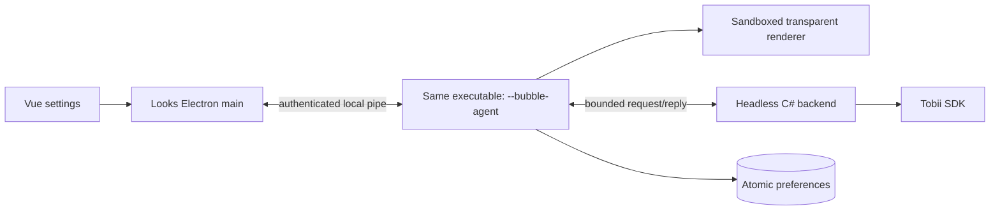

# Bubble: runtime architecture

Issue: #181. One repository, executable and installer; Windows x64 only. The overlay and
tray are Electron. C# is a headless Tobii source, not the standalone WPF application.

## Processes

The bootstrap chooses its role before importing application modules. The agent has a
separate userData partition and single-instance lock. Closing Looks disconnects the
client without closing the agent. Tray exit ends the current session, not the saved choice.
Another Looks launch restores that choice; a broken client connection does not resurrect
the agent automatically. An explicit settings action may start a new session.

## Ownership and interfaces

`BubbleController` serializes every tray/UI mutation. Changes carry an instance UUID,
revision and field patch. The preferences file is replaced atomically before publishing
the next revision. Conflicts return the authoritative snapshot; clients never replay stale
changes. Runtime connection state is separate from saved `enabled` and actual display.

Only the agent writes preferences. Unreadable/future schemas are not overwritten. Legacy
appearance may be imported when no own preferences exist; legacy visibility is never
imported, and the original standalone file is not modified.

The control pipe uses a per-instance random name and 256-bit capability held in the user's
AppData directory. The agent checks inherited Windows ACLs and fails closed if another
ordinary identity can read/write directory entries; POSIX modes alone are not treated as
Windows protection. Cross-user ACL behavior is still a required Windows release check.
No capability is passed on command lines or exposed to the renderer. Only fixed commands
are accepted; there is no arbitrary path/process execution interface. The overlay preload
exposes only frame reads, with sender/frame/URL checks in main and a restrictive page CSP.

The backend owns `Local\LINKa.Bubble` while enabled, so a standalone overlay cannot run
concurrently. On conflict it never starts the SDK or kills another process. The source
holds one latest sample. EOF/shutdown frees SDK resources and the mutex; the agent waits
for actual process exit, with a bounded fallback termination of its own child only.

## Presentation

The C# protocol reports physical primary-screen bounds. TypeScript maps normalized
coordinates into the primary Electron display's DIP bounds; no second scale-factor
division is applied. A geometry change invalidates the current sample/filter.

The presentation retains no coordinate history and rejects non-finite/out-of-screen data.
Samples expire after 300 ms. Both IPC hops conservatively account for round-trip latency;
the renderer independently expires its last frame. There is at most one frame request per
hop and no historical coordinate queue. Smoothing preserves the WPF algorithm; recovery
starts at the first new coordinate rather than travelling from the old position.

The overlay ignores mouse events, cannot focus, never moves the OS cursor and is omitted
from the taskbar. Ordinary windows are supported, not UAC, lock screens or exclusive
fullscreen. No coordinate logs, network reporting or Windows logon startup are added.

## Installation and updates

Windows CI builds a locked net48/x64 backend and validates managed/native PE architecture.
The installer embeds pinned Microsoft .NET 4.8 and VC++ 2012 x64 prerequisites. Downloads
are size/SHA-256/Authenticode verified before staging; build scripts never execute them.

The NSIS running-app check is overridden: an unelevated control request asks the matching
agent/main to quit, and a read-only helper waits for processes from the exact installation.
Timeout or unverifiable ownership aborts; there is no process-name kill fallback. Uninstall
asks the user to close active processes and does not install prerequisites.

An expiring per-user update ticket permits unelevated agent resume after successful install.
Failed/partial installation does not launch potentially mixed binaries. A manual relaunch
is required after a failed update; preferences remain intact. This is not rollback of
application binaries and does not replace the Windows real-upgrade acceptance gate.

## Verification limits

SDK-free lifecycle fixtures and NSIS compile tests are not device or installer qualification.
Release is blocked until the checklist in `bubble-release-checklist.md` is completed,
including parallel Tobii 4C/5 clients, DPI, click-through, elevated/manual updates and
SDK/runtime redistribution rights.
